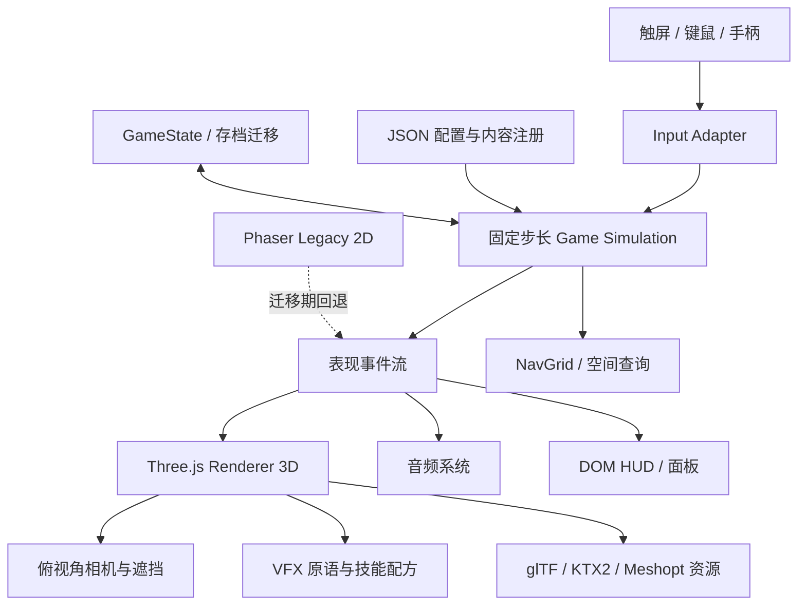

# 《修仙与地下城》原生 3D 俯视角迁移规划

> 规划日期：2026-09-11  
> 代码基线：当前 working tree（`package.json` 0.9.0，`SAVE_VERSION = 14`）  
> 目标：把现有 Phaser 2D/HD-2D 游戏升级为真正由 3D 网格、材质、灯光、动画和相机驱动的俯视角动作 RPG，同时保留当前玩法、数值、存档与内容。

## 1. 决策摘要

### 推荐方案

继续使用 **TypeScript + Three.js + Vite + Capacitor**，把现有 `three-bridge.ts` 演进为独立的原生 3D 渲染内核；Phaser 在迁移期只承载旧场景和少量覆盖层，最终由 Three.js 负责全部世界渲染，DOM 负责 HUD、背包、角色、宗门等界面。

这里的“原生 3D”明确指：

- 地形、墙体、建筑、角色、怪物和掉落物均为真实 3D 网格；
- 角色使用骨骼动画，技能使用粒子、曲线、贴花、模型和 Shader；
- 相机使用透视投影、遮挡处理和动态跟随；
- 灯光、阴影、雾、材质和后处理均在 3D 管线内完成；
- 碰撞和战斗逻辑仍在 XZ 平面计算，不因画面升维而改变数值与规则。

不建议第一阶段切换 Unity/Unreal/Godot。那会同时重写 TypeScript 逻辑、UI、存档、构建和发布链，现有 4.7 万行 TS、683 项测试及大量数据配置的复用率会显著下降。Three.js 已经进入项目并成功用于大世界，是风险最小、内容保留率最高的路线。

### 产品定位建议

视觉目标不应追求写实“3A 暗黑”，而应采用 **国风修仙 + 暗黑地牢气氛 + 手绘低中模 PBR**：

- 中等面数、清楚剪影、偏手绘的材质；
- 青墨、铜金、朱砂、幽紫等现有主题色继续保留；
- 真实 3D 空间配合夸张技能光效，保证手机竖屏下仍能辨认敌我和攻击范围；
- 洞府现有的国风山水、建筑和暖光氛围作为美术基准，不照搬当前像素比例与最近邻渲染规则。

## 2. 当前项目审计结论

### 2.1 工程与内容规模

| 维度 | 当前事实 | 对迁移的影响 |
|---|---:|---|
| TypeScript | 105 个文件，约 46,959 行 | 不适合整体重写，必须分层复用 |
| 场景 | 9 个主要 Scene | 可逐场景迁移并保留旧版回退 |
| 最大场景 | World 4,833 行；Dungeon 4,746 行；Sect 3,293 行 | 场景同时承担规则、生命周期和渲染，是首要技术债 |
| Phaser 直接依赖 | 25 个源文件 | 需要用端口/适配器逐步隔离 |
| 配置内容 | 5 职业、22 怪物、63 装备基座、10 词缀、67 功法、90 天赋节点、30 个 v4 Kit | 全部应保留并继续数据驱动 |
| 运行时资源 | 326 个必需资源完整；1,509/1,510 个可选资源存在 | 2D 资源可作 UI、概念、贴花和迁移期占位，不应直接全部废弃 |
| 自动化测试 | 683 项，当前 677 通过、6 失败 | 先固定基线，再为 3D 适配新增契约测试 |
| 构建 | Web 生产构建成功；已有 Capacitor Android/TapTap/小游戏路线 | Three.js 路线可延续现有发布能力 |

### 2.2 已有 3D 能力

`src/three-bridge.ts` 已具备以下基础：

- Three.js 独立 Canvas 与 Phaser 透明 Canvas 叠放；
- 透视相机、跟随、缩放和 3D→2D 投影；
- 高度场、地表纹理、水面、道路贴花；
- 环境光、半球光、主光、补光、月光和阴影；
- 雾、Bloom、景深、ACES 色调映射；
- 大世界中的建筑立面、植被与角色 Billboard。

这证明 Web/Android 端 3D 技术路线已经能运行，但它目前仍是 **HD-2D 桥**：角色、NPC 和大量场景元素本质上仍是面向镜头的 2D 图片，且桥接器直接依赖 Phaser Scene，不能作为地下城、宗门和城镇共享的完整 3D 引擎。

### 2.3 核心耦合问题

1. `DungeonScene.ts` 同时包含生成、刷怪、AI、伤害、掉落、30 Kit 技能执行、特效、镜头、输入和结算。
2. `entities.ts` 的 Player/Enemy/Ally 直接持有 Phaser Sprite 和 Arcade Body，逻辑实体与显示对象无法独立运行。
3. `v4/scene-adapter.ts` 把技能语义直接翻译为 Phaser 特效调用，不能直接换成 3D 表现。
4. `WorldScene.ts` 同时维护 2D 与 3D 两套显示状态，存在大量 `_useDirect3D` 分支。
5. 现有 `three-bridge.ts` 为每个 Billboard 创建 CanvasTexture，并启用 4096 阴影与完整后处理；直接扩到战斗同屏会造成移动端性能压力。
6. UI 由 DOM、Phaser Graphics 与场景逻辑混合实现；3D 化前需要明确“世界空间 UI”和“屏幕空间 UI”的边界。

## 3. 保留、改造与替换边界

| 系统 | 决策 | 说明 |
|---|---|---|
| `data/*.json`、`data.ts` | 原样保留 | 职业、怪物、装备、功法、套装、地图定义继续作为权威数据源 |
| `core.ts`、`effects.ts`、`skills.ts` | 保留并补纯函数测试 | 掉落、伤害、属性、攻击模式和套装规则与维度无关 |
| `state.ts` 与存档迁移链 | 保留 | 不改变既有存档字段语义；只追加视觉设置和必要的世界位置数据 |
| NPC、弟子、宗门、外交、世界事件、任务 | 保留 | 这些属于领域逻辑，不因 3D 化改规则 |
| `levelgen.ts` | 保留算法，升级输出 | 现有 Tile/Room 结果转换为 3D 地板、墙、门、障碍和 NavGrid |
| `entities.ts` | 拆分 | 纯实体/战斗状态保留；Phaser Sprite/Body 迁入 Legacy2D 适配层 |
| `DungeonScene.ts` | 拆分后替换表现 | 规则抽到 Simulation；Scene 只负责组装、输入、渲染和界面 |
| `three-bridge.ts` | 重构 | 拆成 Renderer、SceneGraph、Camera、Lighting、Asset、VFX 等模块 |
| 角色/怪物像素帧 | 迁移期保留，最终替换 | 可先作为 3D 场景中的 Billboard 占位，正式版本换骨骼模型 |
| 1140 张 v4 单帧图片 | 不直接逐张 3D 化 | 将 30 Kit 还原成“轨迹/元素/命中/持续场”参数，复用少量 3D VFX 原语 |
| DOM UI | 保留并重做视觉皮肤 | 背包、装备、天赋、宗门等复杂面板继续用 DOM 更高效 |

原则：**玩法结果由 Simulation 决定，Renderer 只呈现结果。** 同一场战斗在 2D 和 3D 下应产生一致的伤害、掉落、经验、任务和存档结果。

## 4. 目标架构



### 4.1 建议目录

```text
src/
  domain/             现有 core/effects/state/NPC/宗门等纯规则
  simulation/
    combat/           玩家、敌人、队友、投射物、命中、掉落
    world/            场景对象、交互、时间、任务触发
    spatial/          NavGrid、碰撞、范围查询、视线
  render3d/
    core/             renderer、scene、frame loop、quality profile
    camera/           top-down camera、shake、occlusion、screen projection
    environment/      dungeon、town、sect、world、lighting、weather
    actors/           glTF actor、animation state machine、attachments
    vfx/              projectile、trail、decal、beam、field、impact
    ui3d/             血条、名称、伤害数字、掉落光柱
    assets/           manifest、loader、cache、dispose
  adapters/
    phaser2d/         旧场景兼容与 A/B 回退
    three3d/          Simulation 事件到 3D 表现的映射
  ui/                 DOM HUD 与面板
```

### 4.2 Simulation 最小接口

```ts
interface WorldSnapshot {
  tick: number
  actors: ActorSnapshot[]
  projectiles: ProjectileSnapshot[]
  drops: DropSnapshot[]
  interactables: InteractableSnapshot[]
}

type PresentationEvent =
  | { type: 'attack'; actorId: string; recipeId: string; target: Vec2 }
  | { type: 'hit'; sourceId: string; targetId: string; damage: number; crit: boolean }
  | { type: 'death'; actorId: string }
  | { type: 'drop'; dropId: string; quality: number }
  | { type: 'camera'; preset: string; strength?: number }
```

Simulation 使用 XZ 平面上的 `Vec2`，渲染器映射为 Three.js `Vector3(x, height, z)`。这样不需要为 3D 画面引入完整刚体物理，也不会改变现有走位与伤害判定手感。

## 5. 3D 玩法与镜头规格

### 5.1 相机

- 默认俯角 38°–48°，轻微偏航形成 3/4 视角；场景与 Boss 可用预设切换，但战斗中不允许自由旋转破坏方向感。
- 透视 FOV 建议 32°–42°，保持“微缩模型感”和稳定目标尺寸。
- 手机竖屏：玩家位于屏幕下方约 55%–62%，前方保留更多预判空间。
- PC 横屏：扩大左右视野，不简单拉伸 UI；保留同一战斗距离和敌人攻击预警时间。
- 墙体遮挡采用淡出、裁切球或透明 Dither，禁止镜头被屋顶和前景墙完全遮死。
- 镜头震动分轻/中/重三级，位移与旋转均设上限，支持设置中关闭。

### 5.2 移动与碰撞

- 保留当前虚拟摇杆、键盘移动和自动索敌逻辑。
- 玩家与敌人采用圆形/胶囊体在 XZ 平面移动；高度只由地面采样和跳跃表现驱动。
- 第一阶段使用自研 NavGrid + 圆形分离，直接复用 `LevelMap`；不要立刻引入复杂物理引擎。
- 怪物寻路使用房间连通图 + 局部避障；同屏密集时按帧预算分批更新 AI。
- 点击/触摸交互通过 Raycaster 投射到地面与交互层，UI Canvas 不参与拾取。

### 5.3 地下城构建

`levelgen.ts` 的每个 Tile 转换规则：

| 现有 Tile | 3D 输出 |
|---|---|
| Floor | 合批地板网格 + 区域材质变化 |
| Rock/Wall | 模块化墙、转角、柱、门框；按邻接关系选择模块 |
| Water | 低于地面的水面网格 + 边缘泡沫/毒雾 |
| Pillar | 实例化柱体 + 独立碰撞圆 |
| Room | 灯光组、刷怪点、宝箱点、祭坛点、镜头氛围体积 |

不要“一格一个 Mesh”。地板和墙体应按 Chunk 合并，重复装饰用 InstancedMesh；碰撞仍读 Tile/NavGrid，不从渲染网格反推。

### 5.4 战斗可读性

- 玩家、队友、普通敌、精英、Boss 必须有不同轮廓、底圈和血条层级。
- 所有危险范围统一使用地面贴花：准备态弱光、锁定态实线、爆发态短闪。
- 高伤技能至少提前 350–800ms 给方向/范围预警，Boss 大招按机制延长。
- 伤害数字、暴击、状态和掉落品质继续双编码，不能只靠颜色。
- 后处理不得淹没弹道：Bloom 只作用于精选发光层，景深在战斗中默认关闭或极弱。

## 6. 30 Kit 与技能特效迁移

当前技能系统的价值在“玩法原语组合”，不在 1140 张单帧图本身。建议建立 3D VFX 配方：

```text
技能配方 = 发射方式 + 运动轨迹 + 载体 + 元素材质 + 命中表现 + 持续场 + 镜头/音效
```

首批通用原语：

1. 近战弧斩、突刺、环斩；
2. 直线、往返、回旋、折射、链式投射物；
3. 定点落雷、雷网、雷桩、标记、蓄力；
4. 圆形/扇形/矩形地面场；
5. 光束、剑阵、环绕物、召唤物；
6. 命中火花、元素爆发、残留贴花、死亡溶解。

每个 Kit 只配置：颜色、纹理、模型、宽度、速度、拖尾、爆发形状、时间曲线和声音。先完成 8 个运动/神通原语，再覆盖 30 Kit，可避免按 30 套 × 多阶段重复制作。

## 7. 美术升级方案

### 7.1 风格基线

推荐风格名称：**幽玄国风手绘 3D**。

- 场景：低中模轮廓 + 手绘 PBR 材质，细节主要放在法阵、门窗、碑刻、植被与地面破损；
- 角色：略夸张的 5–6 头身，武器和职业轮廓放大 15%–25%；
- 怪物：按五域生态建立形体语言，不能只换颜色；
- 光色：冷色环境光 + 暖色关键光 + 职业/区域元素光；
- 特效：核心为清楚的形状和节奏，粒子数量服务于层次，不以满屏发光为目标。

### 7.2 资产生产优先级

| 批次 | 资产 | 目的 |
|---|---|---|
| A 垂直切片 | 1 名剑修、3 小怪、1 Boss、青冥地牢模块、10 个 VFX 原语 | 验证完整战斗品质和性能 |
| B 核心内容 | 5 职业、22 怪物基础模型、武器挂点、三大地下城主题 | 覆盖主要刷宝循环 |
| C 社交经营 | 洞府、城镇、宗门建筑套件，NPC 通用体型与换装 | 覆盖非战斗内容 |
| D 大世界 | 五域地表、植被、地标、道路、天气 | 替换现有 Billboard 大世界 |
| E 精修 | Boss 独特动作、剧情镜头、稀有装备外观、环境叙事 | 提升宣传和长线品质 |

### 7.3 角色与动画

- 使用 glTF 2.0；统一骨架、Root Motion 关闭，位移由 Simulation 控制。
- 每个通用人形至少提供 Idle、Run、Attack A/B/C、Cast、Hit、Death、Interact。
- 五职业共享基础骨架和移动动画，攻击/施法按职业补充；NPC 用材质、发型、服装和附件组合。
- 武器、法宝、灵兽使用挂点；装备数值全部保留，第一版不要求 63 个装备基座都有独立外观。
- 动画状态机只消费 Simulation 状态，不在动画事件中直接结算伤害。

### 7.4 材质与贴图预算

- 移动端主材质 1K，英雄/Boss 可 2K；小型道具 512；同类资产优先共用图集。
- ORM 合并通道，法线只用于近景明显收益的资产。
- 使用 KTX2/Basis 压缩、Meshopt/Draco 二选一；上线前必须实机验证解码峰值。
- 地下城模块使用 Trim Sheet、Decal 和顶点色降低贴图数量。
- 现有高质量 2D 洞府背景可作 3D 构图、调色和材质概念参考，不直接贴到立体场景上冒充几何。

## 8. 性能与发布预算

### 8.1 目标档位

| 档位 | 目标 | 典型策略 |
|---|---|---|
| 移动低 | 30 FPS，720p 内部动态分辨率 | 关闭景深、低阴影、低粒子、减少同屏尸体 |
| 移动中高 | 45/60 FPS | 单主光阴影、精选 Bloom、实例化植被 |
| PC Web | 60 FPS，1080p | 高阴影、较高粒子、环境特效完整 |

### 8.2 初始硬预算

- 移动端可见 Draw Calls：常态 ≤ 120，峰值 ≤ 180；
- 可见三角面：常态 ≤ 350k，峰值 ≤ 600k；
- 同时投射动态阴影的角色：≤ 8，其余使用 Blob/烘焙阴影；
- 局部动态灯：可见 ≤ 8，只有 1 个主方向光投射全局阴影；
- 透明粒子：控制 Overdraw，低端机总粒子数建议 ≤ 1,500；
- JS 主线程 Simulation：平均 ≤ 4ms；渲染提交与动画更新平均 ≤ 5ms；
- 首次进入地下城仅加载本区、当前队伍和当前 Kit，禁止恢复 BootScene 全量纹理加载模式。

### 8.3 质量档

创建 Low/Medium/High 三套 QualityProfile，统一控制：渲染比例、阴影尺寸/距离、Bloom、景深、抗锯齿、粒子倍率、植被密度、尸体数量和 LOD。设备自动探测只给默认值，玩家可手动覆盖。

## 9. 分阶段实施路线

### Phase 0：冻结基线与迁移护栏（1–2 周）

目标：确保重构不改变玩法结果。

- 修复或正式登记当前 6 个测试失败；
- 为伤害、掉落、升级、Kit、AI、结算增加固定 Seed 战斗回放测试；
- 建立 2D/3D 共用的坐标、实体 ID、PresentationEvent 契约；
- 记录 3 个基准存档和 5 个性能基准场景；
- 增加 `renderMode: legacy2d | native3d` 灰度开关，旧存档默认可安全进入。

验收：同一输入回放在迁移前后得到相同的 HP、击杀、掉落、经验和结算。

### Phase 1：拆出纯战斗 Simulation（3–5 周）

- 从 `entities.ts` 抽离 Player/Enemy/Ally 的状态与行为；
- 从 `DungeonScene.ts` 抽离命中、投射物、AI、死亡、掉落和结算；
- `v4/executor.ts` 输出语义事件，不再直接依赖 Phaser GameObject；
- Phaser 2D 通过 LegacyRenderer 继续跑，证明重构没有改变现有画面与规则。

验收：旧 2D 地下城仍完整可玩；Dungeon Scene 只做组装，不再直接拥有核心数值规则。

### Phase 2：原生 3D 地下城垂直切片（4–6 周）

- 完成 ThreeRenderer、AssetManager、CameraRig、LightingRig、WorldUI；
- 把青冥山脉一层由 LevelMap 转成 3D 模块；
- 接入剑修、3 小怪、1 Boss、掉落、宝箱、祭坛和房间切换；
- 先以 Billboard 验证玩法，再替换为首批骨骼模型；
- 建立 Low/Medium/High 性能档并跑 Android 真机。

验收：可从标题进入、完成一层、击杀 Boss、拾取装备、结算返回，存档与 2D 一致；中端 Android 稳定 30 FPS。

### Phase 3：完整战斗内容迁移（6–10 周）

- 覆盖 5 职业、22 怪物、精英词缀、队友、灵兽、阵法；
- 建立 VFX 原语库并映射 30 Kit、67 功法和动态套装；
- 迁移三大秘境、无尽、仙界、竞技/宗门战等 Dungeon 子模式；
- 增加 Boss 遮挡、锁敌、地面预警、受击和死亡反馈。

验收：所有战斗入口均能走完，内容覆盖表 100%，不允许静默回退到错误攻击表现。

### Phase 4：城镇、洞府、宗门与大世界（6–9 周）

- 先迁移洞府/城镇，再迁移宗门，最后替换现有大世界 HD-2D Billboard；
- NPC 日程、交互、商店、任务、外交、弟子与建筑经营规则不变；
- 复用统一 NPC 骨架、换装和建筑模块；
- 大世界保留五域地图拓扑，不在本阶段重做世界规则。

验收：9 个主要场景的核心入口、返回路径、任务触发和存档恢复全部通过。

### Phase 5：美术精修、性能与发布（4–6 周）

- 补齐动画、音频空间化、环境叙事、Boss 镜头和稀有掉落表现；
- 移除未引用的 2D 战斗纹理与重复加载，按场景拆包和懒加载；
- 完成 Android/TapTap/PC Web 兼容、发热、内存、切后台恢复和低电量测试；
- 保留 Legacy2D 一个发布周期作为回退，再决定是否删除 Phaser 世界渲染。

验收：全流程回归、目标设备性能、首包/分包、崩溃率和存档兼容全部达标。

## 10. 工期与人员估算

以上为 **工程 + 可用美术资产同步推进** 的估算：

| 配置 | 垂直切片 | 全量可发布版本 |
|---|---:|---:|
| 1 名全职开发 + 外包美术 | 10–14 周 | 9–14 个月 |
| 2 名客户端/图形 + 1 名 3D 美术/TA | 7–10 周 | 5–8 个月 |
| 3 名开发 + 2 名美术/动画 + 1 名 TA/特效 | 5–7 周 | 4–6 个月 |

最大不确定性不是规则代码，而是 5 职业、22 怪物、Boss、建筑与技能特效的 3D 资产产能。若角色模型全部定制且追求高规格，周期需要再增加 30%–60%。

## 11. 风险与止损点

| 风险 | 预警信号 | 止损措施 |
|---|---|---|
| 边做 3D 边改玩法 | 同一技能在 2D/3D 结果不同 | Phase 0 回放契约；画面升级期冻结核心数值 |
| Three + Phaser 双 Canvas 性能过高 | 中端机 GPU 持续满载 | 3D 场景隐藏 Phaser 世界层；最终只保留 DOM UI |
| 资产量失控 | 每个 Kit 都要求独立模型和整套粒子 | 强制 VFX 原语 + 配方复用，先语义后皮肤 |
| 上帝场景继续膨胀 | 新 3D 代码仍写进 DungeonScene | Simulation/Renderer 接口作为合并门禁 |
| 视觉华丽但不可读 | Bloom、雾、粒子遮住预警圈 | 战斗可读性评审早于宣传截图评审 |
| 移动端内存爆峰 | 切场景后纹理/模型不释放 | Asset scope、引用计数、销毁测试、场景级显存预算 |
| 存档损坏 | 3D 设置或位置字段导致旧档失败 | 视觉状态不侵入核心字段；SAVE_VERSION 只在确有数据变更时提升 |
| 美术方向反复 | 首批角色和场景多轮推翻 | 先批准 1 个房间 + 1 英雄 + 1 Boss 的 Style Target |

### 三个正式决策门

1. **Gate A（Phase 0 后）**：纯 Simulation 是否能在旧 2D 中运行；不能则暂停 3D，先继续解耦。
2. **Gate B（垂直切片后）**：中端 Android 是否稳定 30 FPS、战斗是否比 2D 更清楚；不能则缩减材质/灯光/镜头规格。
3. **Gate C（Phase 3 中段）**：30 Kit 是否能通过原语配方覆盖；不能则先发布核心 Kit，禁止无边界追加定制 VFX。

## 12. 建议立即执行的首个 Sprint

两周内只做工程护栏和垂直切片准备，不批量生产 3D 资产：

1. 固定当前 683 项测试基线，处理 6 项已知失败；
2. 新建 `simulation/combat`，抽出 Player/Enemy 的纯状态与固定步长移动；
3. 定义 WorldSnapshot、PresentationEvent 和 RendererPort；
4. 用现有 Phaser 画面实现第一个 LegacyRenderer 适配器；
5. 把 `levelgen.ts` 输出转换为最简单的 Three.js 灰盒地板、墙体和柱体；
6. 加入俯视角 CameraRig、遮挡淡出与触屏 Raycast；
7. 制作一个“青冥地牢 + 剑修 + 守关魔将”的灰盒演示；
8. 在一台目标 Android 真机记录 FPS、Draw Call、三角面、内存和温度。

首 Sprint 的交付物应该是 **规则完全一致的可玩灰盒**，而不是宣传级场景。只有灰盒通过 Gate A，才批准第一批正式角色、Boss 和地牢模块资产。

## 13. 最终验收清单

- 旧存档可进入，装备、功法、天赋、NPC、宗门、任务、世界进度无丢失；
- 5 职业、22 怪物、67 功法、30 Kit 和全部战斗模式有明确覆盖记录；
- 同 Seed/同输入的关键结算与 Legacy2D 一致；
- 竖屏触控、横屏 PC、键鼠和手柄均可操作；
- 墙体遮挡、敌我识别、攻击预警、拾取反馈在最差场景仍清楚；
- Android 中端机 30 FPS，PC Web 60 FPS 达标；
- 切换场景 20 次无持续显存增长，切后台/恢复不黑屏；
- 未授权外部模型、贴图、字体、音效和 AI 资产不得进入发行包；
- 资源按场景懒加载，1140 张旧 v4 图不再无条件进入运行时纹理；
- 生产构建、数据校验、资源校验、自动测试和实机冒烟全部通过。

